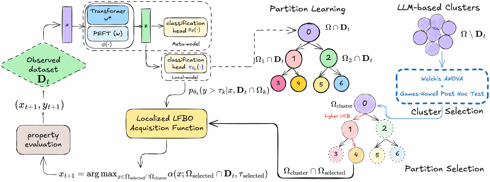

<h1 align="center">Informing Acquisition Functions via Foundation Models for Molecular Discovery</h1>

<p align="center">
  <b>Qi Chen</b><sup>3,4,*</sup>&nbsp;&nbsp;
  <b>Fabio Ramos</b><sup>8,9</sup>&nbsp;&nbsp;
  <b>Alán Aspuru-Guzik</b><sup>1,6,7,10</sup>&nbsp;&nbsp;
  <b>Florian Shkurti</b><sup>1,2,5,6,7,*</sup>
</p>

<p align="center">
  <sup>1</sup>University of Toronto (UofT)&nbsp;&nbsp;
  <sup>2</sup>UofT Data Science Institute&nbsp;&nbsp;
  <sup>3</sup>ELLIS Institute Finland&nbsp;&nbsp;
  <sup>4</sup>Aalto University<br>
  <sup>5</sup>UofT Robotics Institute&nbsp;&nbsp;
  <sup>6</sup>Acceleration Consortium&nbsp;&nbsp;
  <sup>7</sup>Vector Institute<br>
  <sup>8</sup>NVIDIA Research Seattle Robotics Lab (SRL)&nbsp;&nbsp;
  <sup>9</sup>University of Sydney&nbsp;&nbsp;
  <sup>10</sup>Senior Fellow, Canadian Institute for Advanced Research (CIFAR)
</p>

<p align="center">
  <sup>*</sup>Correspondence: qi.chen.inf@aalto.fi, florian@cs.toronto.edu<br>
  The initial work was conducted at the University of Toronto, with subsequent improvements at Aalto University.
</p>

<p align="center">
  
  
</p>

<p align="center">
  
</p>

## News

- **[2026-11]** Code released.

> **Note: this is a temporary release.** The paper contains a large number of experiments, and some details (scripts, configurations, default settings, and the figure-to-code mapping in `paper_figures.md`) still need to be checked against the paper. We will update this repository after the check, so some scripts may not reproduce every result exactly yet.

## Abstract

Bayesian optimization (BO) is widely used to accelerate molecular discovery by reducing costly oracle evaluations. Foundation models provide a promising source of prior knowledge for BO, but simply using their representations in standard surrogate-based pipelines is often unreliable in low-data regimes with high-dimensional features and vast discrete candidate spaces. Rather than asking whether LLMs are universally useful for molecular BO, we ask how Acquisition Functions (AFs) should be designed to exploit weak, high-dimensional, and partially informative foundation-model priors. We propose **LLM-guided Acquisition Tree (LLMAT)**, a surrogate-free BO framework that reformulates likelihood-free acquisition estimation as recursive local acquisition learning. LLMAT trains binary classifiers on LLM representations, where each classifier jointly induces a promising/non-promising partition and defines a local AF within the corresponding region. This produces a hierarchy of localized AFs and enables efficient candidate selection via Monte Carlo Tree Search. To stabilize learning with few observations, LLMAT meta-learns shared classifier parameters and initializations across tree nodes. An optional LLM-guided clustering module further reduces AF evaluation cost by restricting search to statistically promising coarse property clusters. Extensive experiments and ablations demonstrate substantial improvements in scalability, robustness, and sample efficiency for LLM-guided BO in molecular discovery.

## Layout

| Path | Contents |
|---|---|
| `src/algos/llmat/` | LLMAT (tree of shared classifiers, meta-learning, LLM/K-means clustering), toy and multi-objective variants, decoupled MCTS+LFBO ablation |
| `src/algos/baselines/` | LAPEFT (Laplace + LoRA), LFBO/BORE, LA-MCTS baselines |
| `src/bayesopt/` | GP / Laplace surrogates, acquisition functions |
| `src/main/` | Entry points: `run_all.py` (main benchmarks), `run_multiobj_benchmark.py`, `run_noise_ablation.py`, `run_redoxmer_prompt_ablation.py`, `run_api_ablation.py`, `run_baseline_toy.py` |
| `benchmarks/MAT/` | Molecular datasets, feature caching, LLM clustering/prompting; data in `data/` |
| `benchmarks/TOY/` | Levy / Ackley toy benchmarks |
| `configs/` | Experiment configs and the clustering prompt |
| `plotting/` | **All figure/table scripts** (see `paper_figures.md` for figure -> script -> function) |
| `scripts/*.sh` | Run scripts: `run_llmat.sh`, `run_baseline.sh`, `run_multiobj.sh`, `run_prompt_ablation.sh`, `cache_feature.sh`, toy/ablation helpers |
| `scripts/analysis/` | Prompt-ablation and API-clustering analysis helpers |
| `results/` | Raw BO traces (`.npy`) per dataset / feature model / algorithm used by the paper figures (git-ignored for now, distributed separately) |

## Setup

```bash
pip install -r requirements.txt
export WANDB_API_KEY=YOUR_WANDB_API_KEY      # optional, only for experiment logging (or run `wandb login`)
export OPENAI_API_KEY=YOUR_OPENAI_API_KEY    # only to regenerate LLM cluster labels
export HUGGING_FACE_HUB_TOKEN=YOUR_HF_TOKEN  # only for gated models such as Llama-2
```

All commands run from the repository root.

## Running experiments

```bash
for seed in $(seq 0 15); do bash scripts/run_llmat.sh $seed kmeans; done
bash scripts/run_baseline.sh lapeft 0 gp
bash scripts/run_baseline.sh lfbo 0 kmeans
bash scripts/cache_feature.sh redox-mer molformer
```

## Reproducing the figures

```bash
python -m plotting.plot_gap_algorithms_avg   # Fig. 3 left, Llama-2 figure
python -m plotting.plot_fixed                # Fig. 4, best-y figures
python -m plotting.plot_tree_depth_ablation  # tree-depth ablation
python -m plotting.plot_gap_ablation         # module ablation (incl. greedy selection)
python -m plotting.visualize_toy_bo          # Levy-1D toy figures (see scripts/run_visualization.sh)
```

Most plotting scripts enable one function in `__main__`; edit `f_models` / `finetuning` there to choose the figure. Outputs go to `results/figs/` (git-ignored). `paper_figures.md` lists every paper figure with its script and function.

## Data

Large cached files are not tracked by git and must be placed under `benchmarks/MAT/data/`:

- `features/` - cached foundation-model features (`*_feats.bin`, `*_targets.bin`); regenerate with `scripts/cache_feature.sh` (`benchmarks/MAT/cache_features.py`).
- `dataset/` - processed datasets with cached **LLM cluster labels** (`dataset.pkl`). Because the labels come from closed-source APIs, use these files to reproduce the reported LLM-clustering results.
- Already included: raw csv files, LLM clustering outputs (`llm_clustering*`), prompt/API ablation outputs, pretrained GNN weights.

## Notes

- Hyperparameters per feature model are defined in `plotting/load_results.py` (result suffixes) and `configs/`.
- `results/` (about 335 MB, ~76k small `.npy` files) is git-ignored; place it at the repository root to regenerate figures.

## Acknowledgements

Our baseline implementations refer to the following open-source code:

- [wiseodd/lapeft-bayesopt](https://github.com/wiseodd/lapeft-bayesopt) (LAPLACE / LAPEFT baselines and benchmarks, from "A Sober Look at LLMs for Material Discovery")
- [lfbo-ml/lfbo](https://github.com/lfbo-ml/lfbo) (LFBO, likelihood-free Bayesian optimization)
- [facebookresearch/LaMCTS](https://github.com/facebookresearch/LaMCTS) (LA-MCTS search-space partitioning)
